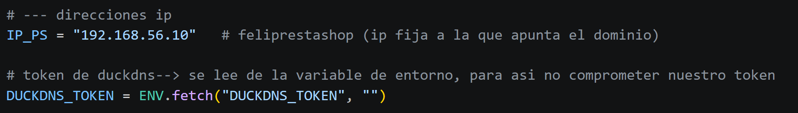

# PrestaShop

# Índice

- Introducción y arquitectura
    - Máquina
    - Seguridad (grupo de seguridad)
    - Estructura de archivos
    - Diferencias con el enunciado
    - Despliegue
- Vagrantfile
- Aprovisionamiento LAMP
- Aprovisionamiento Let’s Encrypt
- Aprovisionamiento PrestaShop
- Comprobaciones
    - Pre-PrestaShop
    - Post-PrestaShop
- Incidencias

---

---

# Introducción y arquitectura

---

En esta práctica implantamos la aplicación PrestaShop sobre una pila LAMP, automatizando todo el proceso mediante scripts de bash. El enunciado plantea hacerlo en una instancia EC2 de AWS, pero lo hemos hecho con una máquina virtual Debian 12 creada con Vagrant (proveedor VirtualBox), reutilizando lo que hicimos en las prácticas anteriores de la pila LAMP y del balanceador de carga con HTTPS.

- **L**inux: Debian 12 (box `debian/bookworm64`).
- **A**pache: servidor web, que sirve la tienda por HTTPS con un certificado de Let’s Encrypt.
- **M**ariaDB: base de datos (compatible con MySQL, ya que Debian 12 no incluye MySQL en sus repositorios oficiales), que también gestionamos desde phpMyAdmin.
- **P**HP: con las extensiones y las directivas que pide PrestaShop, las cuales comprobamos con PhpPsInfo antes de instalarlo.
- **PrestaShop**: instalado por línea de comandos, sin pasar por el asistente web.
- **Dominio**: usamos DuckDNS (`fhuesor01.duckdns.org`) apuntando a la IP fija de la máquina. El certificado se obtiene con Certbot mediante la verificación DNS-01, ya que nuestra IP es privada y Let’s Encrypt no podría entrar a la máquina para comprobar el dominio por el puerto 80.

## Máquina

| Máquina | Función | IP | RAM / CPU | Internet |
| --- | --- | --- | --- | --- |
| feliprestashop | Apache + PHP + MariaDB + phpMyAdmin + PrestaShop | 192.168.56.10 | 2 GB / 2 | Sí (NAT) |

```
                Navegador del anfitrión
                          │  https://fhuesor01.duckdns.org  (DuckDNS → 192.168.56.10)
                          ▼
        ┌──────────────────────────┐
        │      feliprestashop      │ ── NAT ──▶ Internet (paquetes, PrestaShop, Let's Encrypt y DuckDNS)
        │      192.168.56.10       │
        │  Apache + PHP + MariaDB  │
        │ phpMyAdmin + PrestaShop  │
        └──────────────────────────┘
```

- Al ser una sola máquina, la base de datos está en el mismo servidor que la web, por lo que el usuario de la BD (`ps_user`) solo puede conectarse desde `localhost` y solo tiene permisos sobre `prestashop_db`.
- La máquina mantiene la salida a Internet, ya que la necesita para descargar PrestaShop y PhpPsInfo, y Certbot para pedir y renovar el certificado.
- Vagrant añade a la máquina un adaptador NAT que usa para conectarse por SSH; por eso en el firewall permitimos el puerto 22 solo desde `10.0.2.2` (la IP desde la que llega Vagrant).

## Seguridad (grupo de seguridad)

Como no usamos AWS, los elementos de seguridad que pide el enunciado los hemos implementado con sus equivalentes en Vagrant y Linux:

- **IP elástica**: la máquina tiene una IP fija (`192.168.56.10`) definida en el Vagrantfile, y es a la que apunta el dominio de DuckDNS.
- **Grupo de seguridad**: la máquina tiene su propio firewall con `ufw`, que deniega todo el tráfico entrante por defecto y solo permite lo necesario—>

| Puerto | Origen permitido |
| --- | --- |
| 22 (SSH) | 10.0.2.2 (Vagrant) |
| 80 (HTTP) y 443 (HTTPS) | Cualquiera |

Además, en la parte de la aplicación—>

- PhpPsInfo lo protegemos cambiando el usuario y la contraseña que trae por defecto, y lo borramos al instalar PrestaShop, ya que muestra información del servidor.
- Al acabar la instalación borramos la carpeta `install` de PrestaShop y la carpeta del panel de administración se renombra con un nombre aleatorio.
- Las tablas de PrestaShop usan el prefijo `feli_` en vez del de por defecto (`ps_`).

## Estructura de archivos

```
.
├── Vagrantfile
└── scripts/
    ├── .env
    ├── p-scriptlamp.sh
    ├── p-scriptletsencrypt.sh
    └── p-scriptprestashop.sh
```

- `Vagrantfile`: define la máquina (box, hostname, red, recursos y scripts de aprovisionamiento) y la IP fija, además de leer el token de DuckDNS de la variable de entorno.
- `scripts/.env`: todas las variables que usan los scripts (dominio, base de datos, phpMyAdmin, PhpPsInfo y datos de PrestaShop).
- `scripts/p-scriptlamp.sh`: pila LAMP, directivas de PHP, base de datos y usuario, phpMyAdmin, PhpPsInfo, sitio HTTP y firewall.
- `scripts/p-scriptletsencrypt.sh`: certificado de Let’s Encrypt y paso del sitio HTTP a HTTPS.
- `scripts/p-scriptprestashop.sh`: descarga e instalación de PrestaShop por línea de comandos.

> Las credenciales del archivo `.env` son de prueba para un entorno local. El token de DuckDNS nunca se escribe en el repositorio, se lee de una variable de entorno.
> 

## Diferencias con el enunciado

| Enunciado (AWS) | Nuestra práctica (Vagrant) |
| --- | --- |
| Instancia EC2 con Ubuntu Server y mínimo 2 GB de RAM | Máquina Debian 12 con 2 GB de RAM y 2 CPUs |
| IP elástica | IP fija `192.168.56.10` |
| Grupo de seguridad (SSH, HTTP y HTTPS) | Firewall `ufw` |
| Par de claves SSH | Claves que genera Vagrant (`vagrant ssh`) |
| Scripts `install_lamp.sh`, `setup_letsencrypt_https.sh` y `deploy_prestashop.sh` | Scripts `p-scriptlamp.sh`, `p-scriptletsencrypt.sh` y `p-scriptprestashop.sh` |
| Carpeta `conf/` con la configuración de Apache | La configuración de Apache se crea dentro de los propios scripts |
| Código fuente de PrestaShop desde GitHub | Zip oficial desde la web de PrestaShop (ver incidencias) |

## Despliegue

Antes de levantar la máquina, en DuckDNS tenemos que tener creado nuestro subdominio apuntando a la IP fija de la máquina (`192.168.56.10`).

Como el script de Let’s Encrypt necesita el token de DuckDNS y no queremos escribirlo en ningún archivo, lo exportamos como variable de entorno en la misma ventana de PowerShell desde la que hacemos el `vagrant up`—>

```powershell
$env:DUCKDNS_TOKEN = "token_de_duckdns"
vagrant up
```

El `vagrant up` ejecuta los aprovisionamientos de la pila LAMP y de Let’s Encrypt. Si no exportamos el token, la máquina se levanta igual pero el aprovisionamiento de Let’s Encrypt se salta y la web se queda sirviendo solo por HTTP. En ese caso podemos ejecutar más tarde solo ese aprovisionamiento con—>

```powershell
vagrant provision --provision-with letsencrypt
```

Con la máquina ya levantada comprobamos los requisitos en [https://fhuesor01.duckdns.org/phppsinfo.php](https://fhuesor01.duckdns.org/phppsinfo.php), y después lanzamos nosotros el aprovisionamiento de PrestaShop—>

```powershell
vagrant provision --provision-with prestashop
```

Una vez acabado, la tienda está disponible en [https://fhuesor01.duckdns.org](https://fhuesor01.duckdns.org), y la dirección del panel de administración nos la muestra el instalador al final de la salida del aprovisionamiento.

---

---

# Vagrantfile

---

En el principio de nuestro vagrantfile tendremos las variables necesarias para el funcionamiento de este (el resto de variables que usarán los scripts estarán en scripts/.env)—>



Con estas variables ya definidas pasamos a la configuración de la máquina, esta usará el box oficial de Debian 12 (Bookworm)—>


Lo siguiente que estaremos configurando será el nombre de la máquina, su hostname y la interfaz de red privada—>


Seguido de la configuración de las especificaciones de la máquina (Vbox)—>


Ahora pasamos a indicar los scripts de aprovisionamiento, el primero será el aprovisionamiento de la pila LAMP—>


Seguimos con el aprovisionamiento de Let’s Encrypt, el cual comprobamos si se ha introducido en la terminal la variable de entorno necesaria (nuestro token de DuckDNS), si esta ha sido introducida se aprovisiona, si no, no se ejecuta este aprovisionamiento—> 


Y por último estaremos ejecutando nuestro aprovisionamiento de PrestaShop (este lo tenemos que lanzar nosotros ya que antes hay que hacer comprobaciones con PhpPsInfo, ya que este aprovisionamiento lo borra)—>


---

---

# Aprovisionamiento LAMP

---

En nuestro script de aprovisionamiento de la pila LAMP, el cual estará dentro de la carpeta “scripts”, como bien podemos ver en la ruta que especificamos en el vagrantfile, empezaremos cargando las variables del archivo “.env” (en el cual tenemos todas las variables que usan los scripts), seguido de actualizar la lista de paquetes y descargar los paquetes necesarios (Apache, MariaDB, PHP con las extensiones que pide PrestaShop, etc.), con los paquetes ya descargados ajustamos las directivas de PHP que pide PrestaShop en un fichero propio (“99-prestashop.ini”) para no tocar el “php.ini” original, tanto para Apache como para la línea de comandos, seguimos con la creación de la BD y del usuario a través del cual se va a conectar PrestaShop (este solo puede conectarse desde la propia máquina), pasamos a instalar phpMyAdmin dejándole ya respondidas las preguntas del instalador para que no se pare a preguntarnos nada, activamos los módulos de Apache necesarios y creamos el sitio HTTP (este se modifica en el script de aprovisionamiento de Let’s Encrypt cuando tengamos funcionando el certificado), descargamos PhpPsInfo en la raíz del servidor web habiendo borrado “index.html” (el cual nos crea apache por defecto) y le cambiamos el usuario y la contraseña que trae por defecto, hacemos propietario de los archivos de la web al usuario de apache, activamos nuestro sitio y desactivamos el de por defecto, para acabar configurando el firewall, en el cual solo estaremos permitiendo la conexión por ssh desde nuestra ip de vagrant y desde cualquier origen por los puertos 80 y 443 para HTTP y HTTPS—>

```bash
#!/bin/bash

# cargamos las variables del .env quitandole antes los finales de linea de windows (\r)
# set -a hace que todas las variables que cargamos se exporten solas
set -a
source <(sed 's/\r$//' /vagrant/scripts/.env)
# desactivamos la importacion de variables
set +a

# con esta linea hacemos que apt no se pare a preguntarnos nada durante la instalacion
export DEBIAN_FRONTEND=noninteractive

# actualizamos la lista de paquetes e instalamos los necesarios-->
# apache2 (servidor web), mariadb-server (servidor de bd), php y libapache2-mod-php (para que apache ejecute php),
# las extensiones de php que pide prestashop (mysql, curl, gd, intl, mbstring, xml, zip y bcmath),
# unzip y curl (para descargar y descomprimir prestashop) y ufw (firewall)
apt-get update
apt-get install -y apache2 mariadb-server php libapache2-mod-php php-mysql php-curl php-gd \
  php-intl php-mbstring php-xml php-zip php-bcmath unzip curl ufw

# ajustamos las directivas de php que pide prestashop (las comprobamos despues con phppsinfo)
# en un fichero propio dentro de conf.d para no tocar el php.ini original,
# tanto para apache como para la linea de comandos (cli), ya que el instalador de prestashop lo lanzamos por cli
PHP_V=$(php -r 'echo PHP_MAJOR_VERSION.".".PHP_MINOR_VERSION;')
for SAPI in apache2 cli; do
cat > /etc/php/$PHP_V/$SAPI/conf.d/99-prestashop.ini <<EOF
memory_limit = 512M
max_input_vars = 5000
post_max_size = 128M
upload_max_filesize = 128M
date.timezone = Europe/Madrid
EOF
done

# creamos una bd con la variable de vagrantfile (utf8mb4 que es la que pide prestashop)
# y un usuario que solo puede conectarse desde la propia maquina, dandole permisos totales solo sobre esa bd
mysql <<EOF
CREATE DATABASE IF NOT EXISTS $DB_N CHARACTER SET utf8mb4 COLLATE utf8mb4_unicode_ci;
DROP USER IF EXISTS '$DB_U'@'localhost';
CREATE USER '$DB_U'@'localhost' IDENTIFIED BY '$DB_P';
GRANT ALL PRIVILEGES ON $DB_N.* TO '$DB_U'@'localhost';
FLUSH PRIVILEGES;
EOF

# instalamos phpmyadmin sin que nos pregunte nada-->
# con debconf le dejamos respondidas las preguntas del instalador
# (crear su bd, su contraseña y que se configure con apache)
echo "phpmyadmin phpmyadmin/dbconfig-install boolean true" | debconf-set-selections
echo "phpmyadmin phpmyadmin/app-password-confirm password $PMA_P" | debconf-set-selections
echo "phpmyadmin phpmyadmin/mysql/app-pass password $PMA_P" | debconf-set-selections
echo "phpmyadmin phpmyadmin/reconfigure-webserver multiselect apache2" | debconf-set-selections
apt-get install -y phpmyadmin

# activamos los modulos de apache que necesitamos-->
# rewrite (urls legibles de prestashop y redireccion a https), headers (para modificar cabeceras) y ssl (para servir https con el certificado)
a2enmod rewrite headers ssl

# creamos el sitio http (puerto 80), con AllowOverride All para que funcione el .htaccess de prestashop
# cuando el certificado este listo, el script de letsencrypt lo cambia por el sitio https
cat > /etc/apache2/sites-available/prestashop.conf <<EOF
<VirtualHost *:80>
    ServerName $DOMINIO
    DocumentRoot /var/www/html

    <Directory /var/www/html>
        AllowOverride All
        Require all granted
    </Directory>
</VirtualHost>
EOF

# descargamos phppsinfo (script oficial de prestashop que comprueba los requisitos) en la raiz del servidor web,
# habiendo borrado "index.html" (el cual nos crea apache por defecto),
# y le cambiamos el usuario y la contraseña que trae por defecto (prestashop/prestashop) por los del vagrantfile
rm -f /var/www/html/index.html
curl -fsSL -o /var/www/html/phppsinfo.php https://raw.githubusercontent.com/PrestaShop/php-ps-info/master/phppsinfo.php
sed -i \
  -e "s/const DEFAULT_LOGIN = '[^']*';/const DEFAULT_LOGIN = '$PSINFO_U';/" \
  -e "s/const DEFAULT_PASSWORD = '[^']*';/const DEFAULT_PASSWORD = '$PSINFO_P';/" \
  /var/www/html/phppsinfo.php

# hacemos al usuario de apache propietario de los archivos de la web
chown -R www-data:www-data /var/www/html

# activamos nuestro sitio y desactivamos el de por defecto
# para acabar pasando un configtest y reiniciando apache para que se guarden los cambios
# (si ya tenemos el certificado no lo activamos, para no pisar el sitio https al volver a lanzar este script)
a2dissite 000-default
if [ ! -d /etc/letsencrypt/live/$DOMINIO ]; then
  a2ensite prestashop
fi
apache2ctl configtest
systemctl restart apache2

# configuramos el firewall (equivalente al grupo de seguridad de aws)--> ssh solo desde el host de vagrant
# y http/https desde cualquier origen
ufw --force reset
ufw default deny incoming
ufw allow from $IP_VAGRANT to any port 22 proto tcp
ufw allow 80/tcp
ufw allow 443/tcp
ufw --force enable
```

---

---

# Aprovisionamiento Let’s Encrypt

---

En nuestro script de aprovisionamiento de Let’s Encrypt, el cual estará dentro de la carpeta “scripts”, como bien podemos ver en la ruta que especificamos en el vagrantfile, empezaremos cargando las variables del archivo “.env”, comprobamos si está el token en la variable de entorno como se especifica en el vagrantfile, actualizamos la lista de paquetes y descargamos los paquetes necesarios, almacenamos el token en un fichero, para seguir con la creación del hook de autenticación, seguimos con la creación de otro script/hook, pero este para borrar el registro TXT del anterior script (le damos permisos de ejecución a ambos scripts), seguimos pidiéndole el certificado a Let’s Encrypt con la prueba “dns-01”, a continuación creamos el sitio HTTPS (como bien se comenta en el anterior script de aprovisionamiento que íbamos a hacer), cambiamos de HTTP a HTTPS deshabilitando el sitio del aprovisionamiento anterior y habilitando este recién creado, para acabar comprobando la renovación automática del certificado—>

```bash
#!/bin/bash

# cargamos las variables del .env quitandole antes los finales de linea de windows (\r)
# set -a hace que todas las variables que cargamos se exporten solas
set -a
source <(sed 's/\r$//' /vagrant/scripts/.env)
# desactivamos la importacion de variables
set +a

# si no hay token en la variable de entorno paramos y avisamos
# el token se exporta en powershell antes de "vagrant up" como se dice en el vagrantfile
# set -e hace que el script se pare en el primer error para no activar https sin certificado
set -e

if [ -z "${DUCKDNS_TOKEN:-}" ]; then
    echo "Exporta DUCKDNS_TOKEN en PowerShell con: \$env:DUCKDNS_TOKEN = \"tu_token_de_duckdns\" y vuelve a ejecutar este aprovisionamiento"
    exit 1
fi

# actualizamos la lista de paquetes e instalamos certbot (cliente de let's encrypt)
# y curl (lo usan los hooks para hablar con duckdns)
apt-get update
apt-get install -y certbot curl

# guardamos el token en un fichero con permisos solo para root
DIR_HOOKS=/etc/letsencrypt/duckdns
mkdir -p $DIR_HOOKS
echo "$DUCKDNS_TOKEN" > $DIR_HOOKS/token
chmod 600 $DIR_HOOKS/token

# creamos el hook de autenticacion, un script que certbot ejecuta automaticamente
# cuando let's encrypt nos pide demostrar que el dominio es nuestro-->
# certbot le pasa un valor (CERTBOT_VALIDATION) que tenemos que publicar como registro TXT
# en el dominio, y este script lo publica en duckdns usando el token
cat > $DIR_HOOKS/auth.sh <<'EOF'
#!/bin/bash
TOKEN=$(cat /etc/letsencrypt/duckdns/token)
SUBDOMINIO="${CERTBOT_DOMAIN%.duckdns.org}"
RESPUESTA=$(curl -s "https://www.duckdns.org/update?domains=${SUBDOMINIO}&token=${TOKEN}&txt=${CERTBOT_VALIDATION}")
if [ "$RESPUESTA" != "OK" ]; then
    echo "error al actualizar duckdns--> $RESPUESTA"
    exit 1
fi
# en vez de esperar un tiempo fijo, comprobamos cada 15 segundos si google y cloudflare
# ya ven el TXT nuevo (maximo 10 minutos), asi let's encrypt no lo encuentra vacio
for i in $(seq 1 40); do
    G=$(curl -s "https://dns.google/resolve?name=_acme-challenge.${CERTBOT_DOMAIN}&type=TXT")
    C=$(curl -s -H "accept: application/dns-json" "https://cloudflare-dns.com/dns-query?name=_acme-challenge.${CERTBOT_DOMAIN}&type=TXT")
    if echo "$G" | grep -q "$CERTBOT_VALIDATION" && echo "$C" | grep -q "$CERTBOT_VALIDATION"; then
        echo "TXT visible tras $((i*15)) segundos"
        # margen extra para el resto de servidores dns
        sleep 30
        exit 0
    fi
    sleep 15
done
echo "el TXT no se ha propagado en 10 minutos"
exit 1
EOF

# hook de limpieza--> borra el registro TXT al terminar
cat > $DIR_HOOKS/cleanup.sh <<'EOF'
#!/bin/bash
TOKEN=$(cat /etc/letsencrypt/duckdns/token)
SUBDOMINIO="${CERTBOT_DOMAIN%.duckdns.org}"
curl -s "https://www.duckdns.org/update?domains=${SUBDOMINIO}&token=${TOKEN}&txt=removed&clear=true" || true
EOF

# le damos permisos de ejecucion a ambos scripts
chmod +x $DIR_HOOKS/auth.sh $DIR_HOOKS/cleanup.sh

# pedimos el certificado a let's encrypt con la prueba dns-01-->
# en vez de comprobar el dominio por el puerto 80 (nuestra ip es privada y no llegaria),
# let's encrypt comprueba un registro TXT que publican nuestros hooks en duckdns
# certonly (solo saca el certificado, la configuracion de apache la hacemos despues),
# manual + hooks (auth.sh publica el TXT y cleanup.sh lo borra al terminar),
# deploy-hook (recarga apache cada vez que se emite o renueva el certificado),
# -d (dominio del certificado), agree-tos (acepta los terminos),
# register-unsafely-without-email (cuenta sin email) y non-interactive (para que no pregunte nada)
certbot certonly --manual --preferred-challenges dns \
  --manual-auth-hook $DIR_HOOKS/auth.sh \
  --manual-cleanup-hook $DIR_HOOKS/cleanup.sh \
  --manual-public-ip-logging-ok \
  --deploy-hook "systemctl reload apache2" \
  -d "$DOMINIO" --agree-tos --register-unsafely-without-email --non-interactive

# creamos el sitio https--> el puerto 80 redirige a https y el 443 usa el certificado
# y sirve prestashop desde la misma raiz que el sitio http
cat > /etc/apache2/sites-available/prestashop-ssl.conf <<EOF
<VirtualHost *:80>
    ServerName $DOMINIO
    RewriteEngine On
    RewriteRule ^ https://%{HTTP_HOST}%{REQUEST_URI} [L,R=301]
</VirtualHost>

<VirtualHost *:443>
    ServerName $DOMINIO

    SSLEngine on
    SSLCertificateFile /etc/letsencrypt/live/$DOMINIO/fullchain.pem
    SSLCertificateKeyFile /etc/letsencrypt/live/$DOMINIO/privkey.pem

    DocumentRoot /var/www/html

    <Directory /var/www/html>
        AllowOverride All
        Require all granted
    </Directory>
</VirtualHost>
EOF

# cambiamos del http al https
# para acabar pasando un configtest y reiniciando apache para que se guarden los cambios
a2dissite prestashop
a2ensite prestashop-ssl
apache2ctl configtest
systemctl restart apache2

# y por ultimo comprobamos que la renovacion automatica del certificado funcionara
certbot renew --dry-run
```

---

---

# Aprovisionamiento PrestaShop

---

En nuestro script de aprovisionamiento de PrestaShop, el cual estará dentro de la carpeta “scripts”, como bien podemos ver en la ruta que especificamos en el vagrantfile (este no se ejecuta con el vagrant up, lo lanzamos nosotros después de hacer las comprobaciones con PhpPsInfo), empezaremos cargando las variables del archivo “.env”, comprobamos si tenemos el certificado de Let’s Encrypt para saber si instalar la tienda con HTTPS o con HTTP, seguimos descargando PrestaShop de su web oficial dentro de la carpeta tmp (desde la versión 9 ya no se publica en GitHub), vaciamos la raíz del servidor web (borrando así también PhpPsInfo) para descomprimir en ella PrestaShop, eliminamos la descarga de tmp y hacemos propietario de los archivos de la web al usuario de apache, vaciamos la BD por si ya se había instalado antes, para así poder volver a lanzar el script sin errores, pasamos a instalar PrestaShop por línea de comandos con “index_cli.php” con los datos de la BD y del administrador (todos estos datos los sacamos de las variables del archivo “.env”), con PrestaShop ya instalado borramos la carpeta “install” y renombramos la del panel de administración si el instalador no lo ha hecho, borramos la caché, volvemos a hacer propietario de los archivos al usuario de apache y reiniciamos el servicio apache, para acabar mostrando por pantalla las direcciones de la tienda y del panel de administración—>

```bash
#!/bin/bash

# cargamos las variables del .env quitandole antes los finales de linea de windows (\r)
# set -a hace que todas las variables que cargamos se exporten solas
set -a
source <(sed 's/\r$//' /vagrant/scripts/.env)
# desactivamos la importacion de variables
set +a

# set -e hace que el script se pare en el primer error
set -e

# si ya tenemos el certificado de let's encrypt instalamos la tienda con https,
# si no, la instalamos con http para que no nos redirija a un https que no funciona
if [ -d /etc/letsencrypt/live/$DOMINIO ]; then
    PS_SSL=1
    PROTOCOLO=https
else
    PS_SSL=0
    PROTOCOLO=http
fi

# descargamos prestashop de la web oficial dentro de la carpeta tmp
# (desde la version 9 los zip ya no se publican en github)
rm -rf /tmp/prestashop
mkdir -p /tmp/prestashop
curl -fL -o /tmp/prestashop/prestashop.zip \
  "https://assets.prestashop3.com/dst/edition/corporate/$PS_V/prestashop_edition_classic_version_$PS_V.zip?source=vagrant"

# vaciamos la raiz del servidor web (asi tambien borramos phppsinfo, que muestra datos del servidor)
# el zip descargado trae dentro otro prestashop.zip, que es el que tiene la aplicacion,
# asi que descomprimimos el primero en tmp y el segundo en la raiz del servidor web
rm -rf /var/www/html/* /var/www/html/.htaccess
unzip -q /tmp/prestashop/prestashop.zip -d /tmp/prestashop/paquete
unzip -q /tmp/prestashop/paquete/prestashop.zip -d /var/www/html

# eliminamos la descarga de tmp
rm -rf /tmp/prestashop

# hacemos al usuario de apache propietario de los archivos de la web,
# para que prestashop pueda escribir en sus carpetas
chown -R www-data:www-data /var/www/html

# vaciamos la bd por si ya se habia instalado antes, asi podemos volver a lanzar este script sin errores
# (el usuario no hay que volver a crearlo, sus permisos van por el nombre de la bd)
mysql -e "DROP DATABASE IF EXISTS $DB_N; CREATE DATABASE $DB_N CHARACTER SET utf8mb4 COLLATE utf8mb4_unicode_ci;"

# instalamos prestashop por linea de comandos con index_cli.php (hace lo mismo que el asistente web pero sin navegador)
# lo ejecutamos como el usuario de apache (www-data) para que los archivos que genera tengan el propietario correcto-->
# domain y ssl (dominio de la tienda y si usa https), db_* (datos de la bd que creo el script de lamp),
# prefix (prefijo de las tablas, prestashop recomienda no usar el de por defecto "ps_"), name (nombre de la tienda),
# firstname, lastname, email y password (datos del administrador), country, language y timezone (tienda en español para españa)
cd /var/www/html/install
runuser -u www-data -- php index_cli.php \
  --domain="$DOMINIO" \
  --ssl=$PS_SSL \
  --db_server=localhost \
  --db_name="$DB_N" \
  --db_user="$DB_U" \
  --db_password="$DB_P" \
  --prefix=feli_ \
  --name="$PS_T" \
  --firstname="$PS_N" \
  --lastname="$PS_A" \
  --email="$PS_E" \
  --password="$PS_P" \
  --country=es \
  --language=es \
  --timezone=Europe/Madrid
cd /

# borramos la carpeta install, ya que prestashop no deja usar la tienda mientras exista
# y dejarla es un riesgo de seguridad
rm -rf /var/www/html/install

# si el instalador no ha renombrado la carpeta del panel de administracion, la renombramos nosotros
# con un nombre aleatorio, ya que dejarla como "admin" es un riesgo de seguridad
if [ -d /var/www/html/admin ]; then
    mv /var/www/html/admin /var/www/html/admin_feli$(tr -dc 'a-z0-9' < /dev/urandom | head -c 8)
fi

# borramos la cache, volvemos a ajustar el propietario y reiniciamos apache para aplicar los cambios
rm -rf /var/www/html/var/cache/*
chown -R www-data:www-data /var/www/html
systemctl restart apache2

# mostramos por pantalla las direcciones de la tienda y del panel de administracion
CARPETA_ADMIN=$(basename $(ls -d /var/www/html/admin*))
echo "tienda--> $PROTOCOLO://$DOMINIO"
echo "panel de administracion--> $PROTOCOLO://$DOMINIO/$CARPETA_ADMIN"
```

---

---

 

# Comprobaciones

---

## Pre-PrestaShop

---

Lo primero que vamos a comprobar es el estado de la máquina—>


Seguido de la comprobación de la resolución del dominio—>


Ahora pasamos a acceder a la máquina a través de ssh para empezar comprobando su hostname y configuración de red—>


Pasamos a comprobar el estado tanto de Apache como de MariaDB—>


Seguimos con la comprobación de la versión de PHP y nuestro fichero de directivas de PHP—>


Comprobamos los módulos activos de Apache y los sitios activos—>


(Aquí como podemos ver nos está dando el aviso "AH00558", este no es un fallo, simplemente nos está diciendo que no hay un "ServerName" global, pero cada sitio tiene el suyo, por lo que no es problema)

A continuación mostramos el certificado y que funciona la redirección de HTTP a HTTPS—>


Mostramos las BBDD y los usuarios—>


Y las reglas de firewall—>


---

### Navegador

Comprobamos que nuestro certificado funciona correctamente—>


Ahora accedemos a la página “/phppsinfo.php” con nuestras credenciales para comprobar que cumplimos con los requisitos que nos pide PrestaShop—>


Y por último accedemos a la página “/phpmyadmin” con nuestras credenciales para comprobar que la BD se ha creado correctamente—>


---

## Post-PrestaShop

---

Ahora pasamos a lanzar el aprovisionamiento de PrestaShop—>


Comprobamos que se ha borrado PhpPsInfo—>


Ahora desde nuestro navegador pasamos a ver la tienda—>


Comprobamos que tenemos acceso a nuestro Back-Office (la URL la cogemos de la salida del aprovisionamiento de PrestaShop)—>


Y por último accedemos a phpMyAdmin para ver todas las tablas creadas—>


---

---

# Incidencias

---

**-Descarga de PrestaShop desde GitHub**

El enunciado indica descargar el código fuente de PrestaShop desde los tags de su repositorio de GitHub, pero desde la versión 9 PrestaShop solo publica el zip de instalación en su web oficial, por lo que en GitHub no encontrábamos el paquete listo para instalar. Lo solucionamos descargándolo desde el enlace directo que ofrece PrestaShop para instalaciones automatizadas, dejando la versión en la variable `PS_V` del archivo `.env` para poder cambiarla fácilmente.